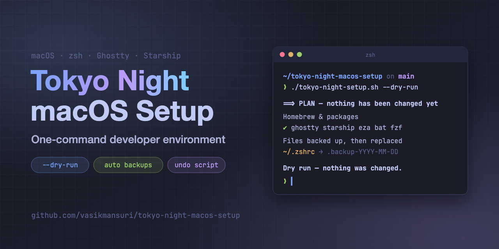

<div align="center">



# Tokyo Night macOS Setup

**One command turns a Mac into a clean, fast developer workstation with a Tokyo Night theme.**<br/>
Ghostty, zsh, Starship, modern CLI tools and Git delta, plus an optional Node, Java, Android and iOS toolchain.


[Quick start](#quick-start) · [What it changes](#what-gets-changed) · [Undo](#backups-and-undo) · [Troubleshooting](docs/TROUBLESHOOTING.md) · [Testing](docs/TESTING.md)

</div>

> **Safe by design.** The script shows you a full plan with diffs before it changes anything, backs up every file it touches, and writes a one-step undo script. Run it with `--dry-run` first to see exactly what would happen.

<!--
  Terminal screenshot: add docs/images/terminal-preview.png (see docs/images/README.md),
  then replace this comment with:
  <p align="center"></p>
-->

## Contents

- [Features](#features)
- [Requirements](#requirements)
- [Quick start](#quick-start)
- [Preview with a dry run](#preview-with-a-dry-run)
- [Options](#options)
- [What gets changed](#what-gets-changed)
- [Backups and undo](#backups-and-undo)
- [Customizing](#customizing)
- [Shell shortcuts](#shell-shortcuts)
- [Manual steps](#manual-steps)
- [Troubleshooting](#troubleshooting)
- [Security and privacy](#security-and-privacy)
- [Testing](#testing)
- [Contributing](#contributing)
- [Credits and license](#credits-and-license)

## Features

**Terminal and shell**
- [Ghostty](https://ghostty.org) with the Tokyo Night theme and JetBrains Mono Nerd Font
- A two-line [Starship](https://starship.rs) prompt in Tokyo Night colors that shows Git, Node, Ruby and Kotlin
- A reorganized `~/.zshrc`. **Your own PATH, exports, tools and aliases are kept.**
- Modern CLI tools: `eza`, `bat`, `fd`, `fzf`, `zoxide`, `btop`, `git-delta`
- zsh autosuggestions and syntax highlighting
- Git diffs through `delta`, with the `zdiff3` conflict style. Your Git name, email and credentials are not touched.
- An optional Tokyo Night profile for the built-in Terminal.app
- The Nerd Font in the built-in terminals of VS Code, Cursor, Windsurf, VS Code Insiders and VSCodium, so icons show there too. Your other settings and comments are kept.

**Developer toolchain (Node, Java, Android, iOS)**
- Watchman, CocoaPods, Ruby, Android Studio and Zulu JDK 17
- Node LTS through `nvm`, with `corepack` enabled
- `JAVA_HOME`, `ANDROID_HOME` and `PATH` in a "Mobile / React Native" section of `~/.zshrc`
- Checks for Xcode and the Android SDK. It never installs Xcode for you.
- Runs `npx react-native doctor` (or `npx expo-doctor` for Expo projects) at the end and suggests a fix for each failing check

**Safety**
- Pre-flight checks, then a full **plan with diffs** before anything changes
- `--dry-run` mode that only shows the plan
- Every file is backed up first as `<file>.backup-YYYY-MM-DD`. Existing backups are never overwritten.
- Checks that a new zsh starts with no errors, and warns if start-up takes longer than 0.3 seconds
- Writes a one-step **undo script**, even if the run stops part-way

## Requirements

- **macOS** on Apple Silicon or Intel. The script stops on any other OS. It doesn't enforce a minimum macOS version, but Homebrew and Ghostty have their own minimums.
- **An admin account**, because Homebrew is installed if it's missing and some steps use `sudo`
- **An internet connection**, for Homebrew, the packages and the bat theme
- **Xcode** from the App Store, only if you want to build for iOS

Run it as your normal user, not with `sudo`. The script refuses to run as root.

> Tested on macOS 26.0.1 (Apple Silicon) with the system bash 3.2: the dry run and the sandboxed [test suite](docs/TESTING.md) pass. A full install on Intel has not been re-verified for this release.

## Quick start

```bash
git clone https://github.com/vasikmansuri/tokyo-night-macos-setup.git
cd tokyo-night-macos-setup

# 1. Preview: shows the plan and diffs, changes none of your config files
./tokyo-night-setup.sh --dry-run

# 2. Apply: shows the plan again and asks before changing anything
./tokyo-night-setup.sh
```

Downloaded only the script file? Run it with bash (no `sudo`): `bash ~/Downloads/tokyo-night-setup.sh --dry-run`. Running it directly without `chmod +x` gives "permission denied".

When it finishes, open Ghostty (or a new terminal window) to see the new setup. In the current window you can run `exec zsh`.

## Preview with a dry run

```bash
./tokyo-night-setup.sh --dry-run
```

The dry run prints:

- which Homebrew formulae and casks are missing
- every file that would be backed up and replaced, with its backup name
- the Git settings that would change, as `current → new`
- the lines it would remove from or de-duplicate in your `~/.zshrc`, and why
- full diffs of the new Ghostty, Starship and zsh configs

Your config files are not touched. The dry run only writes full copies of the new files to `~/.tokyo-night-setup/preview-<timestamp>/` so you can read them.

## Options

| Flag | What it does |
| --- | --- |
| *(none)* | Interactive mode: shows the plan and asks before applying (recommended) |
| `-n`, `--dry-run` | Shows the plan and diffs only. No config files are changed. |
| `-y`, `--yes` | Skips the confirmation prompts |
| `--terminal-app` | Also creates the Tokyo Night profile for Terminal.app |
| `--no-terminal-app` | Skips the Terminal.app profile |
| `--project <dir>` | React Native project to run the doctor in (default: current folder) |
| `-h`, `--help` | Shows help |

## What gets changed

| What | Change |
| --- | --- |
| `~/.config/ghostty/config` | Ghostty theme, font and window settings |
| `~/.config/starship.toml` | Tokyo Night prompt |
| `~/.zshrc` | Reorganized into sections. Your existing PATH, exports and aliases are carried over. |
| `~/.gitconfig` (or `~/.config/git/config`) | `delta` pager and `zdiff3` merge style only |
| bat theme folder | Adds `tokyonight_night.tmTheme` and rebuilds bat's cache |
| Editor `settings.json` | `terminal.integrated.fontFamily`, `fontSize` and `lineHeight` only |
| Terminal.app | New "Tokyo Night" profile, set as default (optional; your current settings are exported first) |
| Homebrew | Installs Homebrew if missing, then any missing packages: `starship eza bat fd fzf zoxide btop git-delta zsh-autosuggestions zsh-syntax-highlighting watchman cocoapods ruby`, plus the casks `ghostty font-jetbrains-mono-nerd-font android-studio zulu@17` |
| Xcode (only if installed) | Selects it with `sudo xcode-select -s` and accepts the license with `sudo xcodebuild -license accept`, only when needed |
| Node (only if `nvm` exists) | `nvm install --lts`, sets `lts/*` as the default and runs `corepack enable` |

If `~/.zshrc` or another config file is a symlink (for example, into a dotfiles repo), the link is kept and the new content is written to the file it points to.

## Backups and undo

Before a file is changed, it is copied next to itself as `<file>.backup-YYYY-MM-DD`. If that name is taken (say, you ran the script twice in one day), the backup becomes `-2`, `-3` and so on. Existing backups are never overwritten.

Each run writes its own undo script, and its path is printed at the end:

```bash
bash ~/.tokyo-night-setup/undo-<timestamp>.sh
```

This puts every changed file back from its backup and removes files the run created. If the run stops part-way (an error, or you press Ctrl-C), the undo script for the changes made so far is still written, and its path is printed.

Things to know about undo:

- **Terminal.app**: quit Terminal.app before running the undo script so it can restore your exported settings.
- **Homebrew packages** stay installed. The undo script lists an optional `brew uninstall` command for the packages that run installed.
- **Xcode**: if the run changed the selected developer directory, the undo script shows the command to switch it back.

You can also restore a single file by hand, for example `cp -p ~/.zshrc.backup-2026-10-15 ~/.zshrc`.

Run records (the list of changed files, the undo scripts and the dry-run previews) are kept in `~/.tokyo-night-setup/`.

## Customizing

The generated files are plain config files, so you can edit them after setup:

- **Ghostty**: `~/.config/ghostty/config` controls the font size, padding, opacity and key bindings. Check your changes with `/Applications/Ghostty.app/Contents/MacOS/ghostty +validate-config`.
- **Prompt**: `~/.config/starship.toml`. See the [Starship configuration docs](https://starship.rs/config/).
- **Shell**: `~/.zshrc` is split into numbered sections. Add your own lines to section 3 ("Your environment") or at the end of the aliases.
- **Slow start-up?** Run `ZSH_PROFILE=1 zsh -i -c exit` to see what takes the time.

Running the script again regenerates these files. It keeps your PATH, exports and aliases, but changes you made to the managed settings (theme, prompt layout, managed aliases) are replaced. Each run makes a new backup first.

## Shell shortcuts

**General**

| Alias | Command |
| --- | --- |
| `ls` / `ll` / `la` / `lt` | `eza` listings with icons and Git status (`lt` = tree view) |
| `cat` | `bat --paging=never` |
| `top` | `btop` |
| `gs` / `gl` / `gd` / `gco` | git status / log graph / diff / checkout |
| `reload` | `source ~/.zshrc` |

**Mobile development (React Native)**

| Alias | Command |
| --- | --- |
| `rn` | `npx react-native` |
| `rns` / `rnsc` | Start Metro / start Metro with a reset cache |
| `rna` / `rni` | Run on Android / iOS |
| `podi` | `bundle exec pod install` in `ios/` |
| `podclean` | Removes Pods, `Podfile.lock` and the build folder in `ios/`, then reinstalls |
| `gradleclean` | `./gradlew clean` in `android/` |
| `adbr` | `adb reverse tcp:8081 tcp:8081` |
| `emus` / `sims` | List Android emulators / iOS simulators |
| `emu [name]` | Starts an Android emulator (the first one if no name is given) |
| `expo` | `npx expo` |

## Manual steps

The script prints anything it can't do for you. Usually this means:

- **JetBrains IDEs** (Android Studio, IntelliJ): set the terminal font to *JetBrainsMono Nerd Font* in *Settings → Editor → Color Scheme → Console Font*.
- **Android SDK**: open Android Studio once, then install the SDK, platform tools and an emulator from *SDK Manager* and *Device Manager*.
- **Xcode**: install it from the App Store, open it once, and accept the license.

## Troubleshooting

| Problem | First thing to try |
| --- | --- |
| Icons show as boxes or question marks | Set the terminal's font to *JetBrainsMono Nerd Font* and open a new window |
| `brew: command not found` after install | Open a new terminal, or run `eval "$(/opt/homebrew/bin/brew shellenv)"` (Intel: `/usr/local/bin/brew`) |
| zsh shows errors on start-up | `zsh -n ~/.zshrc`, then restore the backup or run the undo script |
| The shell feels slow | `ZSH_PROFILE=1 zsh -i -c exit` |
| Ghostty ignores the theme | Look for a second config in `~/Library/Application Support/com.mitchellh.ghostty/config` |

More problems and fixes are in [docs/TROUBLESHOOTING.md](docs/TROUBLESHOOTING.md).

## Security and privacy

- The script never reads or changes your Git name, email or credentials. The script itself collects and sends no data; tools it installs or runs have their own policies.
- It downloads software from the internet: the official Homebrew installer (only if Homebrew is missing), Homebrew packages, the bat theme from [folke/tokyonight.nvim](https://github.com/folke/tokyonight.nvim), Node through `nvm`, and the React Native or Expo doctor through `npx`.
- Backups, previews and the new `~/.zshrc` contain whatever your old `~/.zshrc` had, including any tokens or API keys. **Never paste them into an issue without removing secrets first.**

See [SECURITY.md](SECURITY.md) to report a vulnerability.

## Testing

```bash
bash tests/run-tests.sh
```

The test suite runs every check in a throwaway home folder, so it never touches your real dotfiles. It covers backups, symlinks, paths with spaces, undo (including runs that stop early), the `~/.zshrc` merge and the dry run. [docs/TESTING.md](docs/TESTING.md) describes the full process, including how to test a real install safely in a separate macOS user account or VM.

<!--
  Demo video: once the video is published, add a "Demo" section here with the real YouTube link.
  The outline and narration script are in docs/VIDEO_DEMO.md.
-->

## Contributing

Bug reports and pull requests are welcome. Please read [CONTRIBUTING.md](CONTRIBUTING.md) first. Changes are listed in [CHANGELOG.md](CHANGELOG.md).

## Credits and license

- [Tokyo Night](https://github.com/folke/tokyonight.nvim) color scheme by folke
- [Ghostty](https://ghostty.org), [Starship](https://starship.rs), [eza](https://github.com/eza-community/eza), [bat](https://github.com/sharkdp/bat), [delta](https://github.com/dandavison/delta), [fzf](https://github.com/junegunn/fzf), [zoxide](https://github.com/ajeetdsouza/zoxide)

Released under the [MIT License](LICENSE).

## Support

If this project is useful to you, you can support my open-source work:

<a href="https://buymeacoffee.com/vasikmansuri"></a>
